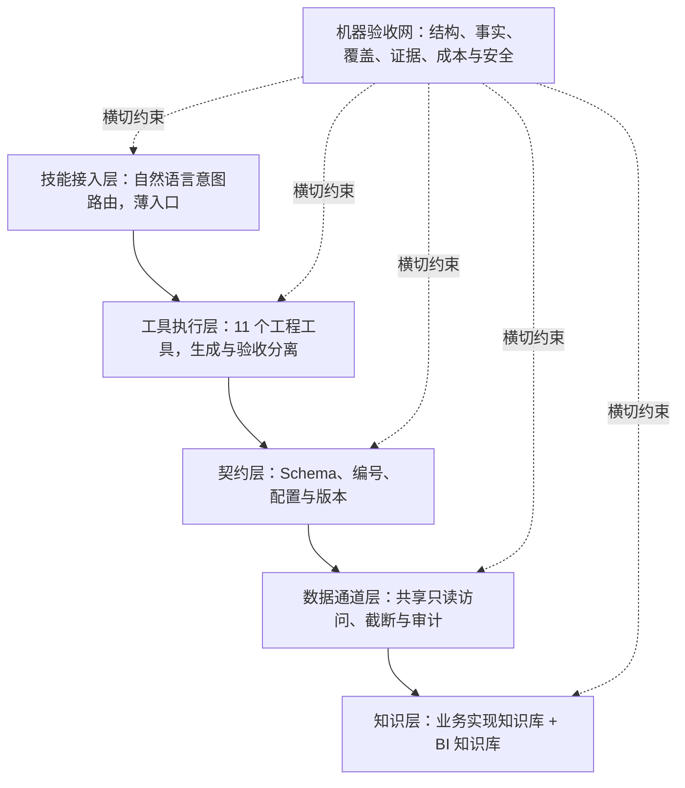

# ai-testing-efficiency-system

**AI 赋能的产研效能治理与可信交付体系｜公开脱敏设计版**

[](LICENSE)
[](docs/)
[](#11-文档演示与阅读路径)

> 从**效能治理经理**视角，系统说明如何把规范、AI、工具链、机器验收、数据通道和知识运营整合为组织生产能力；以**质量负责人**视角补充质量左移、缺陷闭环与可信验收。
>
> 核心主张：**提示词是软约束，工具链是硬约束；AI 产出语义，机器保证确定性，验收结论必须可证伪。**

本仓库公开设计思想、治理方案、实现机理和少量独立示例，**不提供被治理工具体系的完整私有实现源码**。如需源码或核心实现交流，可通过文末邮箱联系作者，并在保密与授权边界内评估可提供内容。

---

## 快速导航

- [项目定位](#1-项目定位治理的是产研系统而非工具数量)
- [治理框架](#2-效能治理框架)
- [体系全景](#3-体系全景与版本口径)
- [工具资产](#4-工具与知识资产全景)
- [核心机理](#5-核心实现机理)
- [E2E-ATW](#6-e2e-atw可信自动化深拆)
- [运营与质量](#7-效能运营与质量治理)
- [治理成效](#8-综合治理成效与统计口径)
- [安全边界](#9-安全权限与适用边界)
- [演进路线](#10-建设路径与演进方向)
- [文档演示](#11-文档演示与阅读路径)
- [作者与许可](#12-作者源码交流与许可)

---

## 1. 项目定位：治理的是产研系统，而非工具数量

这不是一组提示词合集，也不只是一个 UI 自动化项目。它以测试可信化为切入点，将分散在个人经验、Wiki 规范、脚本和 AI 对话中的能力，治理为一套**可执行、可度量、可审计、可推广、可持续演进**的产研工作系统。

### 1.1 要解决的管理问题

| 组织问题           | 局部工具的局限                       | 本体系的治理方案                               |
| ------------------ | ------------------------------------ | ---------------------------------------------- |
| 规范靠个人记忆     | 文档完整但执行不稳定                 | 模板锚点、编号契约、机器检查点与流程准入       |
| AI 产出快但不可信  | 生成量上升，核对与返工同步上升       | 受控 RAG、AI 只产 draft、机器验收后打戳        |
| 工具彼此孤立       | 重复搬运、编号漂移、数据口径不一     | Schema、全局编号、共享只读通道和同源知识       |
| 自动化可能“假绿” | 页面成功被误当业务成功，报告无法重算 | 双轨断言、run_dir 事实源、证据链和 claims 对账 |
| 失败定位依赖专家   | 代码、日志、数据和经验分散           | 症状路由、失败指纹、证据包、AI 研判与 DB 佐证  |
| 经验随人员流失     | 复盘写完即结束，下次重复踩坑         | 回归反哺、人工入库闸、知识保鲜、休眠与淘汰     |
| 工具上线后采用不足 | 只交付功能，不改变流程和责任         | 试点准入、RACI、培训、采用度量与组合运营       |

### 1.2 效能治理与质量治理的关系

- **效能治理是主线**：关注端到端流动、等待、返工、工具采用、交付可预测性、知识复用和成本。
- **质量治理是副线**：关注质量左移、测试充分性、缺陷闭环、证据完整性和发布风险。
- 两者共享同一工程底座：机器准入减少返工，可信证据减少反复确认，知识回流降低同类问题成本。
- 机械执行可以无人值守，业务语义、重大风险、例外接受和发布取舍仍由责任人决策。

### 1.3 项目交付物

| 资产         | 本仓库提供的内容                         | 用途                     |
| ------------ | ---------------------------------------- | ------------------------ |
| 项目总说明   | 治理定位、工具体系、核心机制、运营与边界 | 快速建立完整认知         |
| 四篇设计文档 | 体系治理、E2E 实现、质量闸门、原理术语   | 深入评审与方案复用       |
| 静态演示站   | 体系与工具的可视化历史快照               | 业务和技术视角演示       |
| 机制等价示例 | 契约配置、AI 验收戳、证据链摘要绑定      | 解释关键实现机理         |
| 完整性清单   | 发布文件的 SHA-256 清单                  | 检查公开文件是否发生变化 |

---

## 2. 效能治理框架

### 2.1 三条设计公理

1. **机械环节全脚本化**：解析、校验、执行、汇总、哈希和数字重算等确定性工作交给代码，不依赖人或 AI 手工搬运。
2. **AI 产物必经机器验收**：AI 负责语义生产，但只能生成草稿；下游只消费通过确定性验收且内容摘要匹配的产物。
3. **一切结论可证伪**：数字能回到源产物重算，引用能定位真实证据，运行能独立复核；无法证实的内容必须标记未知或待确认。

### 2.2 四大能力支柱

| 支柱       | 实现机理                                                  | 治理价值                         |
| ---------- | --------------------------------------------------------- | -------------------------------- |
| 工具链路化 | 强制状态序列、生成与验收分离、FAIL 定向修复、超限停机     | 防止跳步、口头放行和无限自动修复 |
| 受控 RAG   | 检索事实、机器备料摘要、AI 生成 draft、引用核验、验收入库 | 在事实围栏内保留语义能力         |
| Agent 编排 | AI 在机器状态机中承担有限角色，消费方校验上游凭证         | 防止 Agent 自任裁判和权限扩大    |
| 自积累成长 | 缺陷回流、失败指纹、定位策略复用、知识衰减与人工入库      | 让每次交付降低下一次成本         |

### 2.3 五层纵向架构与一张横切验收网



**关键架构取舍：**

- 技能层保持薄，不在多个提示词中复制同一套规则。
- 工具通过契约和共享通道联动，而不是直接代码强耦合。
- 每个工具独立演进，跨工具产物必须满足统一 Schema 和编号规则。
- 数据安全物理化在通道中，不依赖模型每次“自觉只读”。
- 验收横切所有层，防止单层合格、层间组合失真。

---

## 3. 体系全景与版本口径

### 3.1 公开设计快照

| 组成         | 快照口径                                             | 说明                                                              |
| ------------ | ---------------------------------------------------- | ----------------------------------------------------------------- |
| 工程工具     | **11 个**                                      | 覆盖详设、评审、规格、编码、单测、用例、E2E、数据、缺陷和专项核验 |
| 知识资产     | **2 座知识库**                                 | 业务实现知识与 BI 系统知识                                        |
| 核心触发技能 | **8 个**，另有项目级与专项技能                 | 自然语言意图进入受控工具链的统一入口                              |
| 机器验收网   | D/R/M/T/G 五类主检查族，展示版 **110+ 检查点** | 横切需求、规格、编码、测试与报告                                  |
| E2E-ATW      | 五源输入、八阶段流水线、版本化 G 闸门                | 自动执行、数据实证、失败归因和可信报告                            |

### 3.2 为什么不同材料中的闸门数量不同

本体系持续演进，公开材料保留了不同时间点的快照：

| 材料                        | 口径                                   | 使用方式                                           |
| --------------------------- | -------------------------------------- | -------------------------------------------------- |
| `site/tools/e2e-atw.html` | V2.2 展示快照，G-01～G-21              | 用于理解当时已公开的流程与可信机制                 |
| 后续源工程契约              | 扩展至 G-01～G-30                      | 增加报告基线、定位健康、断言强度、成本与状态覆盖等 |
| 本仓库 README 与设计文档    | 以机制演进说明为主，展示 30 项检查意图 | 不跨版本累加脚本数、Schema 数或验收成绩            |

**实际项目的权威清单只能是当版 `contract.json`、Schema 注册表和 `--print-checks` 输出。** 文档表格用于解释设计覆盖面，不替代工具注册表。

### 3.3 端到端资产生命周期

```text
需求材料 / 存量源码 / 数据口径 / 业务知识
                  ↓
        详细设计生产 → 独立评审与机器检查
                  ↓
        规格编写 ⇄ 规格验证与契约对拍
                  ↓
        范围解析 → 人工反向确认 → AI 编码
                  ↓
        编译 / 前端规范 / 文档同步 + 单测自检
                  ↓
          AC / TR → 用例与测试数据生产
                  ↓
       E2E 执行 → 数据实证 → 失败分类与缺陷定位
                  ↓
        报告闸门 → 归档 / 离线复核 → 人工终审
                  ↓
          缺陷回归、复盘、规则与知识回流
```

横切约束：规则只有一个事实源，运行事实属于当次 `run_dir`，上游未验收下游不消费，缺陷必须回流为可复用资产。

---

## 4. 工具与知识资产全景

### 4.1 11 个工程工具

| 环节         | 工具                    | 核心机制                                             | 治理产出                                       |
| ------------ | ----------------------- | ---------------------------------------------------- | ---------------------------------------------- |
| 详细设计     | `prd-toolkit`         | 双文档生产、模板锚点、知识与源码双核验、D-01～D-19   | 可机检详设，减少缺章、悬空引用与事实错误       |
| 设计评审     | `rv-toolkit`          | 独立评审、八章报告、引用溯源、版本快照、严重问题禁过 | 生产与评审批分离，问题闭环和趋势可追踪         |
| 规格编写     | `xx-spec-writing`     | 薄编写层、源码审计前置、六步序列、存疑即审计         | 前后端规格成为下游可执行资产                   |
| 规格验收     | `spec-toolkit`        | scaffold/audit/verify/link/diff/fe-code-check/all    | M/L 检查、三文档联动、契约对拍和基线回归       |
| 规格驱动编码 | `xx-spec-coding`      | 范围表达式、必读输入包、反向确认、范围外不动         | 未确认不写码，编译/规范/文档三类验证，超限停机 |
| 单元测试     | `unit-test-selfcheck` | 12 步自检、真实执行原文、SQL 先执行后落笔            | 五份归档报告与十项归档闸，防止只写不执行       |
| 用例与数据   | `tc-toolkit`          | 17 字段 CSV、RFC4180、写入门预校验、T-01～T-21       | AC/TR 同上游，步骤、预期、统计与数据一致       |
| E2E 执行     | `E2E-ATW`             | 五源输入、八阶段、双轨断言、证据链、G 闸门           | 可信执行、数据实证、失败分类与离线复核         |
| 数据核验     | `db-query-assistant`  | 连接级只读、白名单、表到库定位、截断与审计           | 查询模板、业务凭证与章节核验、批次基线对比     |
| 缺陷定位     | `defect-hunter`       | 症状排查、规则扫描、日志检索与多源证据交叉验证       | 代码—日志—AI—数据证据链，缺陷反哺回归       |
| 专项财务核验 | `depr-check-toolkit`  | A～E 排查、S 模拟、T 影子推演、R 反向验证            | 版本化模板、环境差异治理、报告与脚本归档       |

### 4.2 两座知识库与专项能力

| 资产           | 内容边界                                               | 治理机制                                       |
| -------------- | ------------------------------------------------------ | ---------------------------------------------- |
| 业务实现知识库 | 业务流程、规则、状态、异常、联调、代码映射和待确认事项 | 关键结论附事实来源与实证日期，无法实证则待确认 |
| BI 系统知识库  | 视图清单、字段基线、配置模式、常见问题和交付自检       | 仓库脚本、知识基线与运行时事实三方比对         |

专项技能包括缺陷定位、专项财务核验、BI 视图检测、技能安装与同步等，复用“只读、实证、验收、留痕”原则，不重复计入 11 个工程工具。

### 4.3 八个核心触发技能

`xx-prd-detail` · `xx-prd-review` · `xx-spec-writing` · `xx-spec-coding` · `xx-testcase-gen` · `xx-e2e-atw` · `xx-db-query` · `kb-maintain`

技能负责意图识别、必要输入收集和工具调用；规则、权限、状态和验收不依赖模型临场理解。

---

## 5. 核心实现机理

### 5.1 契约化与单一事实来源（SSOT）

`contract.json` 是流程、检查和报告共同消费的规则事实源。规则按版本注册，再分发到 `lint`、`precheck`、`gate` 等通道，避免提示词、脚本和文档各自维护一份口径。

以下为**机制等价示例，不是生产配置或私有源码**：

```json
{
  "version": "public-example-1",
  "schemas": {
    "assert_draft": 1,
    "run_result": 1,
    "attestation": 1
  },
  "rules": {
    "evidence.required": { "channel": "gate", "severity": "FAIL" },
    "ai.max_repair_rounds": { "channel": "gate", "value": 3 },
    "release.require_full_run": { "channel": "gate", "value": true }
  },
  "budgets": {
    "visual_fallback_per_run": 0
  }
}
```

配套机制：

- **Schema 注册**：产物先注册类型与版本，再允许读写。
- **版本迁移**：历史产物显式迁移，不在读取时暗中猜结构。
- **原子写**：临时文件完成并校验后再替换目标，避免半成品被消费。
- **异常显式化**：解析警告、跳过、豁免和待确认项进入结构化产物。
- **清单机器生成**：检查项由注册表输出，避免文档成为另一份漂移的规则源。

### 5.2 受控 RAG 与 AI 三段式

| 阶段       | 责任方 | 核心动作                                               | 准入条件                       |
| ---------- | ------ | ------------------------------------------------------ | ------------------------------ |
| 检索与备料 | 机器   | 从需求、规格、代码审计、数据口径和知识中生成最小 brief | 来源明确、范围受限、缺项可见   |
| 语义加工   | AI     | 按 Schema 生成断言、归因或覆盖判定 draft               | 不得直接修改正式产物           |
| 确定性验收 | 机器   | 校验结构、引用、枚举、证据路径和规则底线               | FAIL 回修 draft，禁止绕过      |
| 打戳与消费 | 机器   | 绑定验收时间与 draft 摘要，下游再次核验                | 无戳、摘要不符或内容变化即拒绝 |
| 业务复核   | 人     | 判断高风险语义、重大缺陷与发布取舍                     | 未复核不得关闭高风险事项       |

**验收戳的本质是把验收行为与当时内容绑定：**

```python
import hashlib
import hmac
import json

STAMP_FIELDS = {"gated_at", "draft_hash"}


def canonical_body(obj: dict) -> bytes:
    body = {k: v for k, v in obj.items() if k not in STAMP_FIELDS}
    return json.dumps(
        body, ensure_ascii=False, sort_keys=True, separators=(",", ":")
    ).encode("utf-8")


def content_hash(obj: dict) -> str:
    return hashlib.sha256(canonical_body(obj)).hexdigest()


def stamp(draft: dict, gated_at: str) -> dict:
    accepted = {k: v for k, v in draft.items() if k not in STAMP_FIELDS}
    return {
        **accepted,
        "gated_at": gated_at,
        "draft_hash": content_hash(accepted),
    }


def is_gated(draft: dict) -> bool:
    if not draft.get("gated_at") or not draft.get("draft_hash"):
        return False
    return hmac.compare_digest(draft["draft_hash"], content_hash(draft))
```

实际实现还需 Schema、权限、审计、原子写和失败恢复。验收戳只能证明“该内容曾通过指定检查”，不能单独证明业务语义绝对正确。

### 5.3 Agent 编排：AI 是执行者，不是裁判

- 唯一入口驱动流水线，阶段依赖由机器判断。
- 上游缺失、版本不符、无验收戳或摘要变化时，下游拒绝消费。
- FAIL 必须回到对应 draft 或源资产修复，不允许直接修改最终报告伪装通过。
- 自动修复通常最多三轮；超限后停止新范围，输出未过项和人工决策点。
- 机械阶段支持无人值守，业务缺陷与高风险语义保留 `pending_review`。

### 5.4 run_dir、证据链与离线复核

每次运行形成独立 `run_dir`，作为该轮事实来源：

```text
run_<timestamp>/
├── run_result.json
├── verify_result.json
├── classify_result.json
├── data_ledger.json
├── triage/
├── evidence/
├── manifest.json
├── attestation.json
└── report/
```

链式哈希把前一环、当前文件摘要和生产阶段绑定：

```python
import hashlib
from pathlib import Path


def file_sha256(path: Path) -> str:
    digest = hashlib.sha256()
    with path.open("rb") as stream:
        for block in iter(lambda: stream.read(1024 * 1024), b""):
            digest.update(block)
    return digest.hexdigest()


def append_record(previous_chain: str, path: Path, producer: str, stage: str) -> dict:
    artifact_hash = file_sha256(path)
    chain_hash = hashlib.sha256(
        f"{previous_chain}:{artifact_hash}:{stage}".encode("utf-8")
    ).hexdigest()
    return {
        "path": path.name,
        "sha256": artifact_hash,
        "producer": producer,
        "stage": stage,
        "chain_hash": chain_hash,
    }
```

离线复核不重跑业务测试，而是独立检查：

1. 文件实际 SHA-256 是否与登记一致；
2. 链式哈希是否因增删、替换或换序而断裂；
3. 报告中的执行数、通过数、失败数等 claims 能否从源产物重算。

### 5.5 数据实证与三态台账

| 状态        | 含义                               | 允许的结论                               |
| ----------- | ---------------------------------- | ---------------------------------------- |
| `ok`      | 已执行且满足明确断言               | 可进入通过统计，仍需满足时效和独立性检查 |
| `fail`    | 已执行且违反断言                   | 必须进入失败、分类和处置流程             |
| `unknown` | 未执行、不可达、证据不足或口径不明 | 只能标记未知，禁止当作成功               |

关键约束：

- UI 表现与数据库事实互相印证，防止“页面成功但未落库”。
- 查询限定本轮时间窗或业务标识，防止旧数据冒充新结果。
- 取样来源与被断言值不能同源恒真。
- 写链路配合快照、数据池与清理台账，失败、跳过和未知均须说明。
- 变更影响分析用于迭代反馈，发布仍须全量链兜底。

### 5.6 知识复利：维护工作流与资产生命周期

**一次知识变更如何可靠写入：**

```text
收集提交 → 筛选变更 → 源码/运行时核验 → 映射知识文档
         → 增量落笔 → 更新版本记录 → 输出维护报告
```

**一条知识如何经历完整生命周期：**

```text
采集 → 核验 → 入库 → 引用 → 保鲜 → 休眠 → 淘汰
```

治理要求：

- 知识按框架层、平台层、项目层组织并就近覆盖。
- 关键结论附来源与实证时间，不编造功能、接口、字段或枚举。
- 不大段复制源码，知识文档提炼业务规则、流程和代码映射。
- 入库前检查完整性、一致性、可执行性与可回溯性。
- 业务缺陷、低置信条目和模型推断先进入 `pending_review`。
- 长期未验证的知识降置信或休眠，不能永远以原优先级参与生成。
- 缺陷复盘至少回流回归用例、检查规则、失败指纹、定位策略或业务知识之一。

### 5.7 缺陷与专项核验

缺陷定位遵循“先证据、后结论”：症状路由选择检索路径，代码说明责任位置，日志说明实际过程，AI 只在证据包内研判，DB 只读结果佐证数据状态。证据不足时输出可疑点和下一步取证计划，确认缺陷后绑定回归用例。

专项财务核验将同一原则扩展为多引擎：计提前检查覆盖与衔接，模拟引擎复算计算式，影子推演验证应有状态，反向引擎从结果逐环回查。断言优先采用等式、覆盖和衔接关系；环境差异通过版本化模板和显式跳过规则治理，预期跳过与执行失败分开记录。

---

## 6. E2E-ATW：可信自动化深拆

### 6.1 五源输入与八阶段流水线

五源输入为**需求文档、规格说明书、代码仓库、数据口径、业务知识库**。代码差异探测可作为可选前置，但最终汇入统一覆盖矩阵。

| 阶段          | 机器职责                                   | AI 边界                              | 失败处理                         |
| ------------- | ------------------------------------------ | ------------------------------------ | -------------------------------- |
| `parse`     | 解析规则、校验、导航、代码拦截点与警告     | 核对覆盖，补充机械解析难以识别的边界 | 输入变化使缓存失效，警告显式记录 |
| `gen`       | 生成用例骨架、执行圈、覆盖矩阵与断言 brief | 只提交断言 draft                     | 回修 draft，不直接改正式产物     |
| `precheck`  | 环境、浏览器、DB、目标地址、知识与安全基线 | 根据故障手册辅助处置                 | 硬闸失败即终止                   |
| `run`       | 探针、只读圈、并行调度、失败证据与遥测     | 对证据包做有限归因                   | 环境二次确认、受控重试、指纹分类 |
| `run_write` | 写链条件执行、快照、数据池与台账           | 无额外权限，视觉兜底默认禁用         | 保留台账，不跳过遗留检查         |
| `verify`    | 执行数据核验并保存真实结果                 | 不改 SQL 结果，不把 unknown 写成 ok  | 按数据、代码和影响范围继续取证   |
| `classify`  | 按规则与指纹分流失败                       | 业务缺陷只给建议结论                 | 业务类强制人工复核               |
| `report`    | 生成报告、重算 claims、执行 G 闸门并归档   | 只做受限业务语言润色                 | 任一硬闸 FAIL 禁止归档           |

### 6.2 效率机制不能牺牲可信

- **缓存级联失效**：只跳过输入未变阶段，上游变化必须使依赖产物失效。
- **断点续跑**：状态游标与运行目录可追踪，不能借续跑绕过中间闸。
- **读写分圈**：只读用例与写链隔离，写链默认串行并独立管理台账。
- **调度优化**：失败优先、慢文件治理和最长处理时间优先（LPT）装箱只改善窗口，不改变统计口径。
- **TIA**：代码变更映射测试点、用例和规格；零映射或横切变更回退全量，迭代圈不得冒充发布全量。
- **失败复跑**：只用于确定性判断，不用重跑后通过抹掉首次失败。
- **熔断恢复**：批量环境失败时停止无效消耗，保留证据，恢复后从明确状态续跑。

### 6.3 定位、断言与成本治理

**定位链**：稳定策略优先，DOM 指纹等确定性降级在后，视觉建议默认关闭。显式开启后仍禁止坐标点击，必须完成唯一匹配、可交互和位置复验；写链默认禁用，重复依赖兜底转人工治理。

**断言强度**：通过比较符翻转、期望值扰动和冗余识别等变异探测，验证断言是否真能捕获错误，避免“有断言但恒真”。

**AI 成本**：成本事件与已验收产物绑定；无产物事件、漏记成本、连续预算超限分别进入异常、披露或阻断。没有可靠 token 数据时不做无依据换算。

### 6.4 G 闸门的六组防线

| 检查组     | 主要防线                                           |
| ---------- | -------------------------------------------------- |
| G-01～G-08 | 结构、编号、状态、证据、汇总、反幻觉与报告基本形态 |
| G-09～G-12 | 规则覆盖、CSV/spec 映射、数据台账与基线回归        |
| G-13～G-16 | 证据时效、引用与证据包、claims 对账、flaky 风险    |
| G-17～G-21 | 用例转化、专项核验、截图标注、代码覆盖与影响分析链 |
| G-22～G-26 | 报告导航、自包含、业务语言、取样独立性与报告基线   |
| G-27～G-30 | 定位链健康、断言强度、AI 成本审计与状态迁移覆盖    |

<details>
<summary><strong>展开查看 G-01～G-30 的公开机制清单</strong></summary>

> 本表解释设计意图；硬闸、软闸、豁免和历史兼容策略以当版项目契约为准。

完整的 G-01～G-30 检查意图表见 [03-治理机制与质量闸门](docs/03-治理机制与质量闸门.md)。README 不维护一份手工复制的清单，避免与契约注册表漂移。

</details>

### 6.5 可证伪自测

| 威胁样本                     | 应触发的防御                             |
| ---------------------------- | ---------------------------------------- |
| 陈旧数据或旧报告冒充本轮结果 | 时间窗、运行链绑定、证据新鲜度           |
| 修改、删除或替换产物         | 文件摘要、链式哈希、证据包对账           |
| 报告数字虚报                 | claims 从源产物独立重算                  |
| AI 引用不存在的字段或证据    | 引用存在性、路径与摘要校验               |
| 断言与业务规则脱钩           | 双轨断言、覆盖语义、取样独立性与变异探测 |

不同历史版本分别保留攻击样本和准入自检记录，不将不同范围的成绩混成一个数字。每次封版都应重新执行攻击样本拦截回归、全脚本可运行检查和发布准入检查。

---

## 7. 效能运营与质量治理

### 7.1 角色协同

R=执行，A=最终负责，C=协商参与，I=知会。

| 治理事项             | 效能治理经理 | 质量负责人 | 产品/研发负责人 | 平台或安全角色 |
| -------------------- | ------------ | ---------- | --------------- | -------------- |
| 治理策略与工具组合   | A/R          | C          | C               | C              |
| 工具链建设与运营     | A/R          | C          | C               | R              |
| 质量标准与机器闸门   | R            | A          | C               | C              |
| 业务规则与验收口径   | C            | R          | A/R             | I              |
| 发布质量终审         | C            | A/R        | R               | I              |
| 权限、数据与安全边界 | C            | C          | I               | A/R            |
| 度量、复盘与改进     | A/R          | R          | C               | C              |

### 7.2 指标树：不看生成量，看有效交付

| 维度       | 代表指标                                          | 防失真要求                                 |
| ---------- | ------------------------------------------------- | ------------------------------------------ |
| 流动效率   | lead time、cycle time、评审等待、返工、按期交付率 | 区分工作与等待，固定需求粒度和同类项目队列 |
| 工具采用   | 活跃项目、有效触发、流程完成、人工绕行、例外到期  | 不用安装量或调用次数代替真实采用           |
| 质量结果   | 缺陷密度、逃逸率、检出率、变更失败率、重复缺陷    | 统一严重度、去重、观察窗和缺陷归属         |
| 测试可信度 | 证据完整、claims 对账、陈旧证据拦截、未知占比     | unknown 不得算通过，软门与硬门分开统计     |
| 自动化健康 | flaky、环境失败、定位脆弱度、断言强度、慢文件     | 复跑不能删除首次失败事实                   |
| 知识复利   | 知识命中、复用、新鲜度、休眠、缺陷回流完成率      | 命中须结合答案有效性和人工反馈             |
| AI 成本    | 每个已验收产物成本、重试成本、预算超限            | 成本与验收结果绑定，不追求调用量           |
| 风险合规   | 越权拦截、敏感泄露、例外数量、审计完整性          | 严重安全事件不能被效率收益抵消             |

### 7.3 运营节奏

1. **每日异常治理**：硬闸失败、环境阻断、权限异常与待复核业务缺陷。
2. **每周工具运营**：采用、失败模式、修复轮次、慢步骤与成本异常。
3. **每迭代质量复盘**：逃逸、返工、误报、flaky 和例外，决定资产更新。
4. **每月组合治理**：比较收益与维护成本，决定扩展、整改、合并或退出。
5. **每季度基线校准**：同环境复测性能与质量基线，清理过期承诺。

### 7.4 质量负责人视角的质量左移

| 阶段       | 质量关注点                          | 机器支撑                         | 人工责任                   |
| ---------- | ----------------------------------- | -------------------------------- | -------------------------- |
| 需求与设计 | 规则、异常、边界和验收口径          | D/R 检查、引用溯源、评审闸       | 确认业务取舍与严重问题     |
| 规格与编码 | 契约一致、范围受控、存量兼容        | M/L 检查、契约对拍、编译与代码闸 | 确认跨系统与高风险变更     |
| 测试生产   | 覆盖真实、数据可执行、步骤预期一致  | 17 字段契约、T 检查、覆盖矩阵    | 判断风险优先级与语义充分性 |
| 执行与核验 | 环境可信、UI/数据一致、失败分类准确 | 探针、双轨断言、三态台账、证据包 | 复核业务缺陷与争议根因     |
| 报告与发布 | 数字可重算、证据新鲜、边界披露      | G 闸门、claims、哈希链、离线复核 | 决定例外、风险接受与发布   |
| 复盘与预防 | 同类缺陷不再发生                    | 回归反哺、知识入库、规则复用     | 审核知识有效性与优先级     |

失败分类统一为 `env`、`case-infra`、`case-data`、`case-deps`、`biz` 五类。只有排除环境、用例工程、数据和依赖问题后，才进入疑似业务缺陷；`biz` 必须人工确认。

---

## 8. 综合治理成效与统计口径

以下为既有实践中的脱敏历史结果，保留比例与趋势，隐去绝对业务基数。

| 维度               | 历史结果                                 | 管理含义                               |
| ------------------ | ---------------------------------------- | -------------------------------------- |
| 线上缺陷密度（DI） | 下降 **94%+**                      | 质量左移、过程约束与缺陷闭环的综合结果 |
| 缺陷逃逸率         | **4.7% → 0.73%**                  | 流出到生产环境的缺陷占比降低           |
| 缺陷检测率         | **75.5% → 88.4%**                 | 发布前发现问题的能力提升               |
| 重复性工作         | 工具链承接 **60%+**                | 人工从机械生产与核对转向判断和决策     |
| 迭代交付           | 准时率 **98%**，SLA **100%** | 交付可预测性与协同稳定性改善           |

**口径声明：**

1. 结果是流程治理、团队管理、质量建设与工具链共同作用的结果，不能全部归因于某一个 AI 工具。
2. 不将不同时间窗、项目群或缺陷范围的数据拼接为新的因果结论。
3. 缺陷检测率与逃逸率按各自既有口径呈现，缺少共同分母和同期队列定义时不宣称互补。
4. 新看板必须固定同类项目队列、周期、严重度、去重规则和回补窗口。
5. 性能、执行时长与资源消耗只有在同环境、同范围、同数据基线下复测后才作为当前成效。

---

## 9. 安全、权限与适用边界

### 9.1 数据与执行安全

- 数据库账号和连接双重只读，SQL 白名单与参数化执行，危险写操作在通道层拒绝。
- 表到库定位、结果截断、敏感字段最小化与全量审计。
- 测试与生产配置分离，生产核验默认只读；秘密信息不进入提示词、报告或仓库。
- 写链仅在授权测试范围执行，配合快照、数据池、业务标识和清理台账。
- 知识库区分只读基线与可回写区域，自动学习不得直接修改权威知识原文。
- 对外报告不暴露连接信息、内部拓扑、客户数据或私有代码。

### 9.2 不承诺的能力

- 不替代真机与完整兼容性矩阵。
- 不把步骤耗时遥测当成性能压测。
- 不把报告防篡改描述成对被测系统的安全渗透测试。
- 不承诺 AI 业务判断完全无人复核。
- 不把局部影响分析运行当成全量发布证明。
- 不把机器全绿等同于业务风险为零。

### 9.3 威胁模型边界

链式哈希与离线复核主要防御意外陈旧组合、事后改数、证据替换和报告虚报，不能独立防御拥有高权限且愿意系统性重算整条链的恶意内部操作者。更高要求的环境还需只追加存储、外部签名、独立审计日志、权限分离和第三方时间戳。

---

## 10. 建设路径与演进方向

### 10.1 推广路径

| 阶段        | 关键动作                                     | 退出标准                           |
| ----------- | -------------------------------------------- | ---------------------------------- |
| 0. 基线诊断 | 选择真实痛点，记录周期、返工、质量与成本基线 | 问题可量化，边界与责任人明确       |
| 1. 单点打透 | 优先高频、可验证、风险可控场景               | 产物可被第三方复核，不只是演示成功 |
| 2. 可信固化 | 补 Schema、闸门、证据、权限与失败恢复        | 异常路径和攻击样本拦截回归通过     |
| 3. 流程嵌入 | 接入真实迭代、角色分工和发布准入             | 团队能独立使用，绕行原因可追踪     |
| 4. 契约联动 | 复用编号、通道和知识，连接上下游             | 无重复搬运，跨工具口径一致         |
| 5. 规模运营 | 培训、度量、成本、版本和知识运营             | 收益跨周期复现，维护成本在预算内   |

推广原则：**先治可信再追速度，先单点打透再平台化，知识与工具同建，运营与建设同时开始。**

### 10.2 状态声明

**已落地或由现有材料验证的机制**

- 详设、独立评审、规格编写与验证、规格驱动编码、单测自检。
- 用例与数据生产、E2E 八阶段、双轨断言、证据链和报告闸门。
- 共享只读通道、缺陷证据链、专项财务多引擎核验。
- 双知识库、知识维护流、人工入库闸与经验回流。
- 受控 RAG、AI 验收戳、契约化配置和跨工具 Schema 联动。

**持续校准事项**

- 用例转化档位和启发式规则准确性。
- 历史项目基线、旧产物迁移和跨版本契约兼容。
- 同环境性能、并发与资源消耗复测。
- 定位健康、断言强度、知识有效性与成本收益长期趋势。

**规划中方向，不作为既有成果宣传**

- 协作平台与 IM 的工作项受理、澄清和状态回写。
- 评审模型向更多产品与研发角色扩展。
- BI 视图从检测进一步走向受控自动化建设。
- 更完整的项目初始化、组织看板与跨团队治理能力。

---

## 11. 文档、演示与阅读路径

### 11.1 设计文档

| 文档                                                    | 重点内容                                                    | 适合读者                     |
| ------------------------------------------------------- | ----------------------------------------------------------- | ---------------------------- |
| [01-体系设计总览](docs/01-体系设计总览.md)               | 效能治理框架、组合治理、RACI、度量推广与非 E2E 核心契约实例 | 管理者、效能与质量负责人     |
| [02-E2E-ATW设计实现说明](docs/02-E2E-ATW设计实现说明.md) | 八阶段、AI 三段式、证据链、执行与知识机制                   | 测试架构师、工具与平台工程师 |
| [03-治理机制与质量闸门](docs/03-治理机制与质量闸门.md)   | 假绿防御、30 项检查意图、失败治理与安全边界                 | 质量负责人、审计与发布角色   |
| [04-体系原理与术语说明](docs/04-体系原理与术语说明.md)   | 设计原理、指标口径和术语表                                  | 非技术协作者与初次阅读者     |

### 11.2 静态演示站

`site/` 是公开可视化快照，其中 E2E 深度页保留 V2.2 的 21 道闸门口径。后续机制扩展以本 README 和设计文档为准，不把演示站数字理解为永久当前值。

本地预览：

```bash
python -m http.server 8000 --directory site
```

然后访问 `http://localhost:8000/`。如需 GitHub Pages 或其他静态托管，应将 `site/` 配置为实际发布目录或构建产物；本仓库不依赖特定平台才能阅读设计文档。

### 11.3 推荐阅读顺序

- **管理者**：README 第 1～4、7～10 章 → docs/01 → docs/04。
- **质量负责人**：README 第 5～9 章 → docs/03 → docs/02。
- **工程与平台角色**：docs/02 → docs/03 → README 机制等价示例。
- **首次接触 AI 工程化的读者**：docs/04 → README → 静态演示站。

### 11.4 公开文件完整性

仓库提供 [MANIFEST.sha256](MANIFEST.sha256)，用于检查公开文件是否与清单一致。该清单只提供完整性校验，**不在缺少签名文件时宣称能够单独证明作者身份或 GitHub 提交签名状态**。具体说明见 [AUTHORS.md](AUTHORS.md)。

---

## 12. 作者、源码交流与许可

### 作者

**马龙｜效能治理经理**

专注研发效能治理、AI 工程化、质量治理与可信交付，具有测试团队管理和跨角色产研协同实践，持有 ACP 敏捷管理认证。

- **邮箱：**[18519030819@126.com](mailto:18519030819@126.com)
- **优先方向：**效能治理经理 / 研发效能负责人
- **协同方向：**质量负责人 / 测试负责人
- **地点：**北京

### 源码与脱敏边界

- 本仓库不包含 11 个工程工具及私有业务系统的完整实现源码；`site/` 中公开的 HTML/CSS/JS 仅为演示站自身资产。
- 文中的配置与 Python 代码是独立、脱敏、机制等价示例，不对应真实公司工程，也不能直接还原私有实现。
- 已移除公司名、客户名、内部系统名、内部项目号、环境地址、数据库凭据和真实业务数据。
- 如需源码或核心实现交流，可联系作者，并在保密与授权边界内评估可提供内容。
- 历史指标仅保留比例与趋势，绝对业务基数不公开。

### License

[CC BY-NC-ND 4.0](LICENSE)：署名、非商业使用、禁止演绎。欢迎链接与交流；引用请注明作者和出处，转载与修改分发须遵守许可文本。

---

> **机器事实，AI 语义；生成与验收分离，结论与证据同行。**
>
> 本项目建设的不只是一组工具，而是一套能够跨人员、跨项目、跨版本持续工作的产研治理能力。
